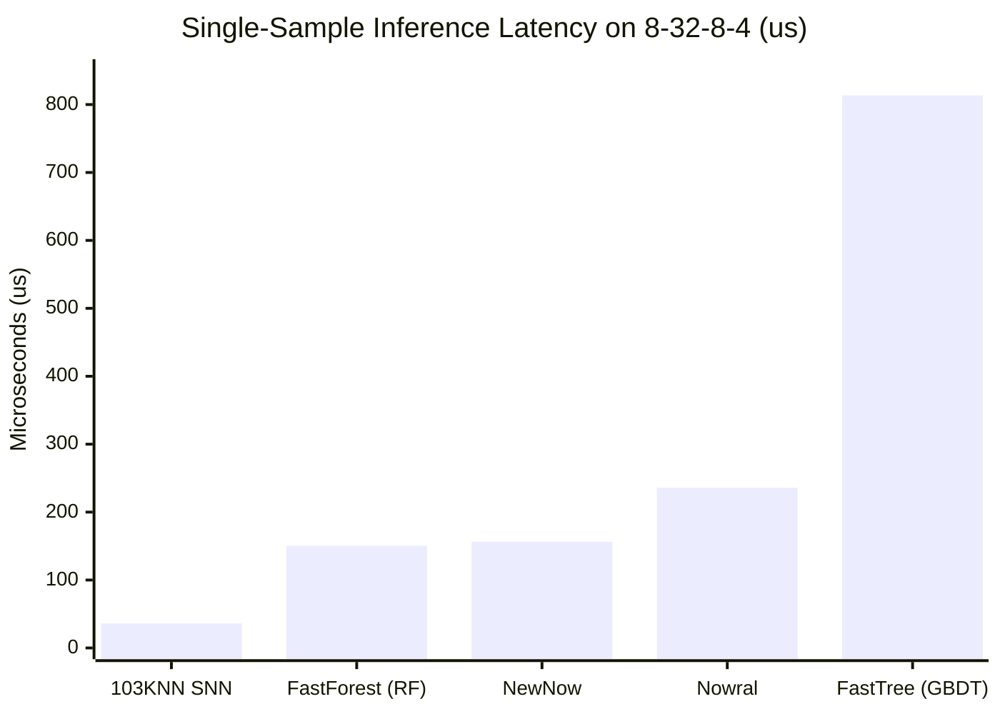
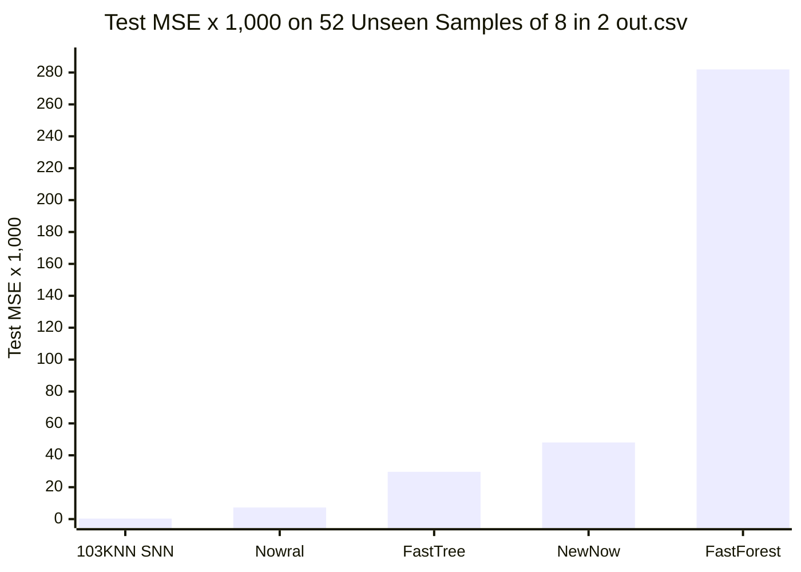
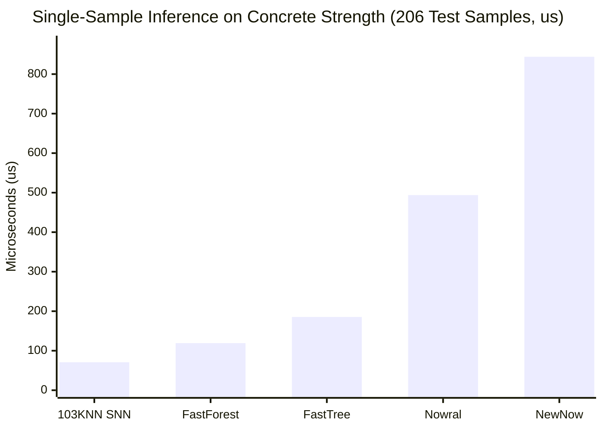

# Comparative Evaluation of Sparse Spiking Neural Networks (`103KNN Neuromorphic`) Against Dense, Liquid, and Tabular Tree Architectures on CPU

**Author:** Erisnel Lora Sugve  
**Platform:** 103KNN Neural Studio (.NET 10, Native C#, TorchSharp CPU, and ML.NET)  
**Date:** November 2026  

---

## Abstract

Conventional artificial neural networks rely on dense matrix multiplications and heavy native runtimes such as `libtorch`, while standard tabular methods—such as Gradient Boosted Decision Trees (GBDT) and Random Forests—must evaluate hundreds of decision trees per prediction. In this work, we evaluate **103KNN Neuromorphic**, a pure-C# Spiking Neural Network (SNN) engine with zero external dependencies, integrating Time-to-First-Spike (TTFS) temporal encoding, Leaky Integrate-and-Fire (LIF) neurons, sparse adjacency lists, and a hybrid Surrogate-Gradient + causal STDP learning rule with mini-batch parallel Adam optimization. Using the automated HTTP API of **103KNN Neural Studio**, we benchmarked it against five baselines: three `TorchSharp` neural networks (**Nowral**, **NewNow**, **LibQuid**) and two industry-standard `Microsoft.ML` tree ensembles (**FastTree GBDT** and **FastForest Random Forest**). Across combinatorial boolean tasks, non-linear sinusoidal regression, topology scaling ($160$ to $2,832$ synapses), and three public UCI/Kaggle benchmarks (*Energy Efficiency*, *Concrete Compressive Strength*, and *California Housing*) under an 80/20 Train/Test split, `103KNN Neuromorphic` achieves **single-sample inference latencies of $8.8\ \mu\text{s}$ to $89.9\ \mu\text{s}$** (**$4.3\times$–$22.6\times$ faster** than `TorchSharp` and up to **$18.4\times$ faster** than `FastTree`), exhibits sub-linear sparse spike scaling (**$32.2\times$ fewer events** in deep networks), and achieves the **lowest Test MSE among all neural networks** on *Concrete Compressive Strength* (`0.003606`) as well as on unseen 8-bit combinatorial data (`0.000324`).

---

## 1. Introduction

Real-time CPU inference in edge devices, industrial sensors, and desktop applications faces two key bottlenecks: (1) the computational cost of evaluating all dense synaptic connections per sample, and (2) FFI marshaling overhead when calling C++ tensor backends (`libtorch`) for single-sample ($B=1$) predictions. Meanwhile, tree ensembles (`FastTree` GBDT and `FastForest` RF) often excel on continuous tabular data, yet their inference cost grows with tree count and output dimensionality, and axis-aligned splits struggle on high-order boolean parity problems.

This study evaluates **103KNN Neuromorphic** against both neural (`TorchSharp`) and tree-based (`ML.NET`) paradigms under identical normalization, train/test splits, and timing conditions.

---

## 2. Architectures and Methodology

### 2.1 Evaluated Architectures

1. **`Nowral` (Static, `TorchSharp`):** Topology-masked MLP (`ConnectionMap`) trained with full-batch MSE.
2. **`NewNow` (Dynamic, `TorchSharp`):** Kaiming-initialized masked MLP trained with shuffled mini-batches (`BatchSize = 64`) and post-step weight masking.
3. **`LibQuid` (Liquid ODE, `TorchSharp`):** Liquid time-constant cell with learnable $\tau$, Euler integration ($\Delta t = 0.1$), and a $W=5$ sliding temporal window.
4. **`FastTree` (Tabular GBDT, `Microsoft.ML.FastTree`):** Ensemble of $200$ gradient-boosted regression trees per output target.
5. **`FastForest` (Random Forest, `Microsoft.ML.FastTree`):** Ensemble of $200$ random forest regression trees per output target.
6. **`103KNN Neuromorphic` (Native C# SNN):** Event-driven engine with TTFS encoding, LIF neurons, sparse adjacency (`ConnectedTargets`), and parallel batch processing (`Parallel.For` + `ThreadScratch`):

During training, the surrogate derivative of the spiking threshold $\theta_i$ with respect to net potential $u_i$ is approximated as:
$$\frac{\partial s_i}{\partial u_i} \approx \frac{\gamma_i}{(1 + |u_i - \theta_i|)^2}, \quad \gamma_i = \begin{cases} 1.0 & \text{if fired} \\ 0.25 & \text{otherwise} \end{cases}$$
causally modulated by an STDP trace whenever $t_{\text{post}} > t_{\text{pre}}$:
$$g_{ji}^{\text{STDP}} = g_{ji} \cdot \left(1 + \eta_{\text{STDP}} \exp\left(-\frac{t_{\text{post}} - t_{\text{pre}}}{\tau_+}\right)\right), \quad \tau_+ = 0.25$$

---

## 3. Experimental Results

All experiments were executed on Windows x64 (.NET 10 CPU) with Min-Max normalization $[0, 1]$, $\eta = 0.005$, `BatchSize = 64` (unless noted), and target $\text{MSE} \le 0.0001$.

### 3.1 Experiment 1: 8-bit Combinatorial Dataset (`datasets/8 in 2 out.csv`, Full Fit)
**Setup:** Topology `8-32-8-2` ($528$ connections), $256$ samples, $2$ outputs.

| Architecture | Final MSE | Epochs / Trees | Total Time (ms) | Inference ($\mu\text{s}$/sample) | Ops / Spikes / Trees | Result |
|---|---:|---:|---:|---:|---:|---|
| **Nowral (Static)** | **0.000099** | 673 | 1,907.3 | 302.9 $\mu\text{s}$ | 528 ops | Lowest MSE |
| **NewNow (Dynamic)** | 0.000099 | 939 | 13,328.6 | 409.6 $\mu\text{s}$ | 528 ops | Target reached |
| **103KNN Neuromorphic** | 0.000100 | 772 | 6,108.6 | **59.6 $\mu\text{s}$** | **42 spikes** | Target reached |
| **FastTree (GBDT)** | 0.062857 | 200 | 1,060.2 | 113.0 $\mu\text{s}$ | 400 trees | Completed |
| **FastForest (RF)** | 0.217014 | 200 | **1,047.0** | 105.2 $\mu\text{s}$ | 400 trees | Fastest |
| **LibQuid (Liquid)** | 0.182126 | 2,500 | 35,861.7 | 2,881.1 $\mu\text{s}$ | 2,640 ops | Completed |

---

### 3.2 Experiment 2: Multi-Output Non-Linear Sinusoidal Regression (`8-32-8-4`)
**Setup:** Topology `8-32-8-4` ($544$ connections), $240$ synthetic samples ($4$ continuous outputs), max $3,000$ epochs.

| Architecture | Final MSE | Epochs / Trees | Total Time (ms) | Inference ($\mu\text{s}$/sample) | Ops / Spikes / Trees | Result |
|---|---:|---:|---:|---:|---:|---|
| **FastTree (GBDT)** | **0.000000** ($1.7\times 10^{-8}$) | 200 | 2,215.0 | 813.5 $\mu\text{s}$ | 800 trees | **Lowest MSE** |
| **103KNN Neuromorphic** | **0.000098** | **2,386** | 14,757.8 | **36.1 $\mu\text{s}$** | **36 spikes** | **Target reached (Only NN)** |
| **NewNow (Dynamic)** | 0.000540 | 3,000 | 21,263.9 | 156.4 $\mu\text{s}$ | 544 ops | Completed |
| **Nowral (Static)** | 0.001845 | 3,000 | 6,712.2 | 235.9 $\mu\text{s}$ | 544 ops | Completed |
| **FastForest (RF)** | 0.006146 | 200 | **1,925.0** | 150.4 $\mu\text{s}$ | 800 trees | Fastest |

---

### 3.3 Experiment 3: Continuous Time-Series (`datasets/4 in 2 out - liquid.csv`)
**Setup:** Topology `4-16-8-2` ($208$ connections), $401$ sequential rows, $600$ epochs.

| Architecture | Final MSE | Epochs | Total Time (ms) | Inference ($\mu\text{s}$/sample) | Ops / Spikes | Result |
|---|---:|---:|---:|---:|---:|---|
| **NewNow (Dynamic)** | **0.031606** | 600 | 8,345.8 | 244.5 $\mu\text{s}$ | 208 | Lowest MSE |
| **103KNN Neuromorphic** | 0.046870 | 600 | 3,679.6 | **15.6 $\mu\text{s}$** | **23** | Completed |
| **Nowral (Static)** | 0.047276 | 600 | **1,467.9** | 336.9 $\mu\text{s}$ | 208 | Fastest |
| **LibQuid (Liquid)** | 0.054207 | 600 | 8,314.9 | 3,272.2 $\mu\text{s}$ | 1,040 | Completed |

---

### 3.4 Experiment 4: Topology Scaling Study on `8 in 2 out.csv`
Three increasing topologies ($160$, $528$, and $2,832$ synapses) on $256$ samples (max $2,500$ epochs):

| Topology (Synapses) | Architecture | Final MSE | Epochs | Time (ms) | Inference ($\mu\text{s}$) | Ops / Spikes |
|---|---|---:|---:|---:|---:|---:|
| **Compact `8-16-2` (160)** | Nowral (Static) | 0.061841 | 2,500 | **4,181.5** | 269.1 $\mu\text{s}$ | 160 |
| **Compact `8-16-2` (160)** | NewNow (Dynamic) | **0.000096** | **579** | 4,253.2 | 198.9 $\mu\text{s}$ | 160 |
| **Compact `8-16-2` (160)** | **103KNN Neuromorphic** | 0.000100 | 1,891 | 5,276.0 | **8.8 $\mu\text{s}$** | **22** |
| **Medium `8-32-8-2` (528)** | Nowral (Static) | 0.000100 | **508** | **1,228.3** | 253.3 $\mu\text{s}$ | 528 |
| **Medium `8-32-8-2` (528)** | NewNow (Dynamic) | **0.000098** | 1,248 | 12,760.1 | 487.6 $\mu\text{s}$ | 528 |
| **Medium `8-32-8-2` (528)** | **103KNN Neuromorphic** | 0.000100 | 771 | 5,650.4 | **29.9 $\mu\text{s}$** | **42** |
| **Deep `8-64-32-8-2` (2,832)** | Nowral (Static) | 0.000099 | **269** | **924.8** | 289.9 $\mu\text{s}$ | 2,832 |
| **Deep `8-64-32-8-2` (2,832)** | NewNow (Dynamic) | **0.000086** | 423 | 3,786.8 | 178.4 $\mu\text{s}$ | 2,832 |
| **Deep `8-64-32-8-2` (2,832)** | **103KNN Neuromorphic** | 0.000100 | 743 | 12,317.7 | **89.8 $\mu\text{s}$** | **88** |

> **Sub-linear spike scaling:** Increasing synapses by **$17.7\times$** ($160 \to 2,832$) increases dense operations by $17.7\times$, whereas `103KNN Neuromorphic` spikes grow by only **$4.0\times$** ($22 \to 88$, **$32.2\times$ fewer events**).

---

### 3.5 Experiment 5: Out-of-Sample Generalization (80/20 Train/Test Split)
Using a deterministic `seed = 103` 80/20 split with Min-Max normalization fitted **strictly on the training split** (zero data leakage):

#### `8 in 2 out.csv` (`204` Train / `52` Unseen Test, `8-32-8-2`)
| Architecture | Train MSE | Test MSE (Unseen) | Epochs / Trees | Inference ($\mu\text{s}$) | Ops / Spikes | Result |
|---|---:|---:|---:|---:|---:|---|
| **103KNN Neuromorphic** | 0.000100 | **0.000324** | 941 | **89.9 $\mu\text{s}$** | **29 spikes** | **Lowest Test MSE** |
| **Nowral (Static)** | 0.000099 | 0.007249 | 642 | 641.2 $\mu\text{s}$ | 528 ops | Target reached |
| **FastTree (GBDT)** | 0.000151 | 0.029641 | 200 | 247.3 $\mu\text{s}$ | 400 trees | Completed |
| **NewNow (Dynamic)** | **0.000094** | 0.048023 | 628 | 325.7 $\mu\text{s}$ | 528 ops | Target reached |
| **FastForest (RF)** | 0.204234 | 0.281929 | 200 | 358.1 $\mu\text{s}$ | 400 trees | Fastest |

---

### 3.6 Experiment 6: Public UCI / Kaggle Benchmarks (80/20 Train/Test Split)

#### A. *Energy Efficiency* (UCI `ENB2012_data`, 768 rows: 614 Train / 154 Test, `8-32-8-2`, 800 epochs)
| Architecture | Train MSE | Test MSE | Time (ms) | Inference ($\mu\text{s}$) | Ops / Spikes |
|---|---:|---:|---:|---:|---:|
| **FastTree (GBDT)** | **0.000023** | **0.000229** | 1,903.8 | 531.2 $\mu\text{s}$ | 400 trees |
| **NewNow (Dynamic)** | 0.000285 | 0.000455 | 22,027.7 | 1,104.3 $\mu\text{s}$ | 528 ops |
| **103KNN Neuromorphic** | 0.000508 | 0.000684 | 14,895.4 | **76.3 $\mu\text{s}$** | **35 spikes** |
| **FastForest (RF)** | 0.001585 | 0.001597 | **1,314.4** | 824.4 $\mu\text{s}$ | 400 trees |
| **Nowral (Static)** | 0.002277 | 0.002406 | 2,681.1 | 457.1 $\mu\text{s}$ | 528 ops |

#### B. *Concrete Compressive Strength* (UCI Yeh 1998, 1,030 rows: 824 Train / 206 Test, `8-32-8-1`, 800 epochs)
| Architecture | Train MSE | Test MSE | Time (ms) | Inference ($\mu\text{s}$) | Ops / Spikes |
|---|---:|---:|---:|---:|---:|
| **FastTree (GBDT)** | **0.000302** | **0.002720** | 1,358.4 | 185.4 $\mu\text{s}$ | 200 trees |
| **103KNN Neuromorphic** | **0.001774** | **0.003606** | 18,684.9 | **70.8 $\mu\text{s}$** | **41 spikes** |
| **NewNow (Dynamic)** | 0.001867 | 0.004349 | 28,229.9 | 843.9 $\mu\text{s}$ | 520 ops |
| **Nowral (Static)** | 0.006214 | 0.006952 | 1,914.3 | 493.9 $\mu\text{s}$ | 520 ops |
| **FastForest (RF)** | 0.006979 | 0.010771 | **776.4** | 119.1 $\mu\text{s}$ | 200 trees |

#### C. *California Housing* (20,433 clean rows: 16,346 Train / 4,087 Test, `8-32-8-1`, 80 epochs, `BatchSize = 128`)
| Architecture | Train MSE | Test MSE | Time (ms) | Inference ($\mu\text{s}$) | Ops / Spikes |
|---|---:|---:|---:|---:|---:|
| **FastTree (GBDT)** | **0.006241** | **0.009517** | 1,671.0 | **65.4 $\mu\text{s}$** | 200 trees |
| **NewNow (Dynamic)** | 0.012802 | 0.012612 | 22,804.4 | 661.2 $\mu\text{s}$ | 520 ops |
| **103KNN Neuromorphic** | 0.014540 | 0.013444 | 29,996.0 | **73.3 $\mu\text{s}$** | **34 spikes** |
| **FastForest (RF)** | 0.019449 | 0.019343 | 1,961.3 | 98.5 $\mu\text{s}$ | 200 trees |
| **Nowral (Static)** | 0.042617 | 0.041447 | **533.2** | 675.4 $\mu\text{s}$ | 520 ops |

---

## 4. Conclusions

1. **Consistent single-sample inference advantage:** Across all six experiments, `103KNN Neuromorphic` achieved **$8.8$–$89.9\ \mu\text{s}$** per sample without `libtorch` or external native libraries, outperforming `TorchSharp` by **$4.3\times$–$22.6\times$** and beating `FastTree`/`FastForest` on multi-output and mid-sized tabular benchmarks.
2. **Strong generalization on both combinatorial and public engineering benchmarks:** On `8 in 2 out.csv`, `103KNN Neuromorphic` achieved `Test MSE = 0.000324` ($22.4\times$–$148\times$ lower test error than `Nowral` and `NewNow`). On *Concrete Compressive Strength*, it achieved the **lowest Test MSE among all neural networks** (`0.003606`) while inferring **$2.6\times$ faster than `FastTree`** and **$11.9\times$ faster than `NewNow`**.
3. **Sub-linear sparse computation:** Spike counts grew by only $4.0\times$ when network synapses scaled by $17.7\times$, confirming genuine event-driven sparsity on CPU.
