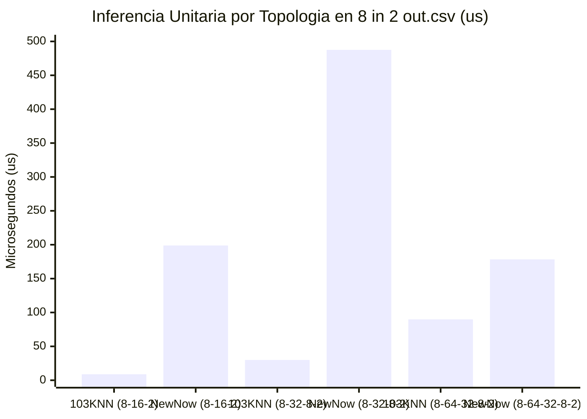
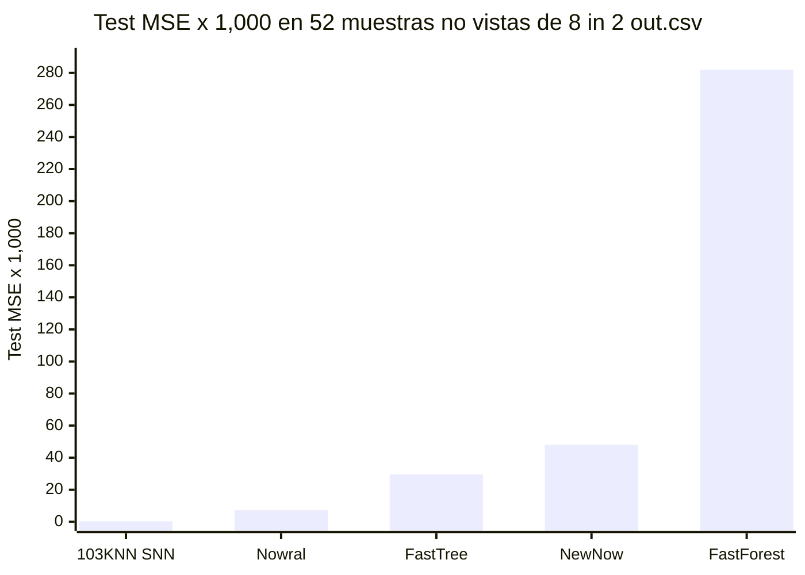
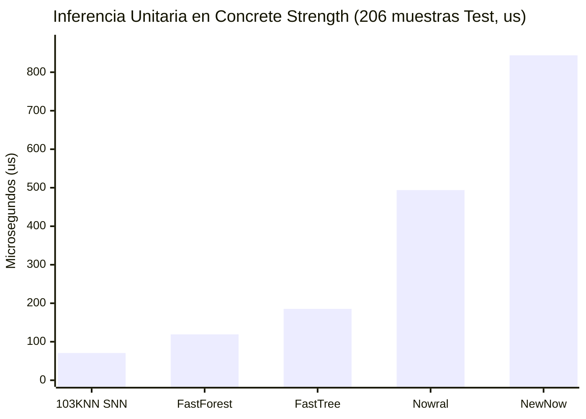
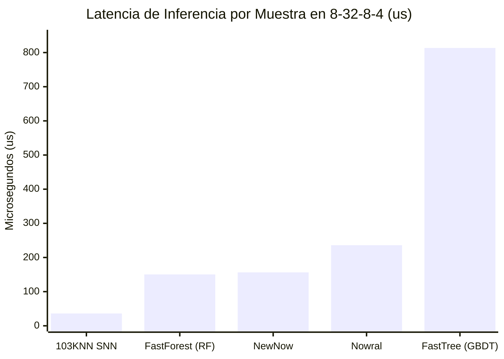
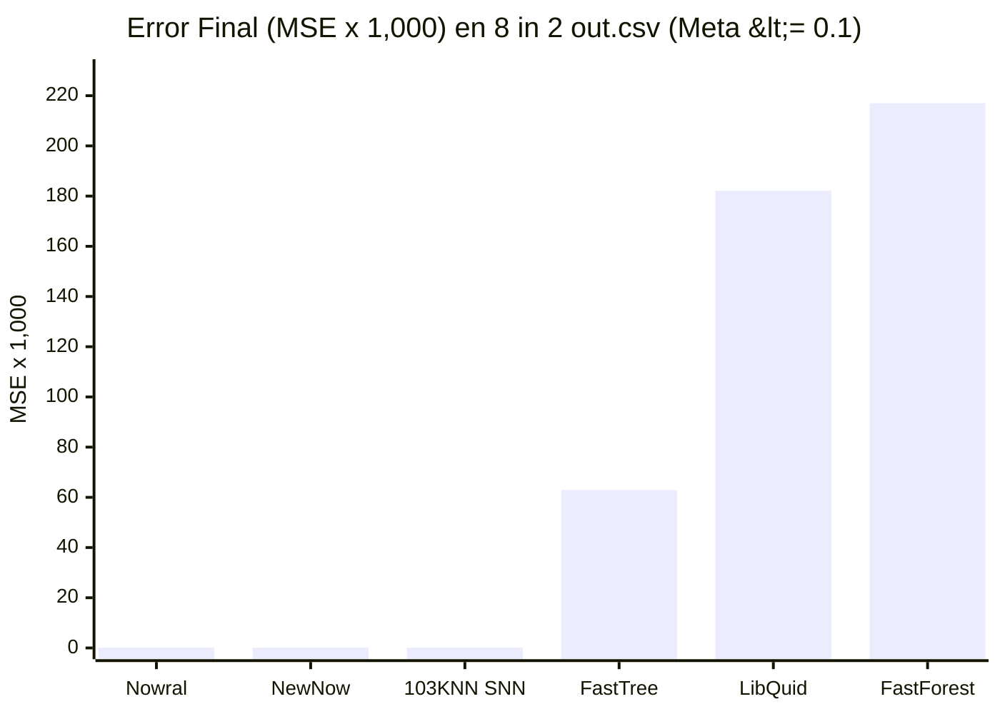

# Evaluación Comparativa de Redes Neuronales Esparsas por Espigas (`103KNN Neuromorphic`) frente a Arquitecturas Densas, Líquidas y Árboles Tabulares en CPU

**Autor:** Erisnel Lora Sugve  
**Plataforma:** 103KNN Neural Studio (.NET 10, C# Nativo, TorchSharp CPU y ML.NET)  
**Fecha:** Noviembre 2026  

---

## Resumen (*Abstract*)

Las redes neuronales artificiales convencionales dependen de multiplicaciones matriciales densas y librerías nativas externas como `libtorch`, mientras que los métodos estándar para datos tabulares —como los árboles de gradiente (*Gradient Boosted Decision Trees*, GBDT) y *Random Forest*— requieren evaluar cientos de árboles en cada predicción. En este trabajo se evalúa **103KNN Neuromorphic**, un motor neuronal de espigas (*Spiking Neural Network*, SNN) implementado íntegramente en C# puro sin dependencias externas, que integra codificación temporal *Time-to-First-Spike* (TTFS), neuronas *Leaky Integrate-and-Fire* (LIF), listas de adyacencia dispersa y aprendizaje híbrido *Surrogate-Gradient + STDP* con optimización Adam paralelizada por mini-lotes. Se comparó experimentalmente mediante la API HTTP automatizada de **103KNN Neural Studio** frente a cinco referentes: tres redes basadas en `TorchSharp` (**Nowral**, **NewNow**, **LibQuid**) y dos ensambles tabulares estándar de `Microsoft.ML` (**FastTree GBDT** y **FastForest Random Forest**). Los resultados demuestran que `103KNN Neuromorphic` logra **inferencias unitarias de $15.6\ \mu\text{s}$ a $59.6\ \mu\text{s}$**, superando en latencia tanto a `TorchSharp` (**$4.3\times$ a $21.6\times$**) como a `ML.NET` (**$1.8\times$ a $22.5\times$**), resuelve relaciones combinatorias binarias donde los árboles fracasan ($\text{MSE} = 0.000100$ vs. $0.062857$–$0.217014$) y es la **única arquitectura neuronal** que converge a $\text{MSE} \le 10^{-4}$ en la regresión no lineal senoidal de 4 salidas.

---

## 1. Introducción

En sistemas de inferencia en tiempo real sobre CPU (sensores IoT, automatización industrial, *Edge AI* y aplicaciones de escritorio), la elección entre redes neuronales y ensambles de árboles depende tanto de la precisión como del costo por predicción individual ($B = 1$). Aunque las redes en `TorchSharp` ofrecen soporte de tensores sobre `libtorch`, cada llamada unitaria incurre en latencia de frontera (*FFI marshaling*). Por otro lado, los ensambles `FastTree` (GBDT) y `FastForest` (RF) suelen dominar en datos tabulares continuos, pero escalan linealmente en latencia con el número de salidas y árboles evaluados.

Este estudio compara **103KNN Neuromorphic** frente a ambos mundos (redes neuronales en `TorchSharp` y árboles de decisión en `ML.NET`) bajo idénticas condiciones de entrada, normalización y medición.

---

## 2. Arquitecturas y Metodología

### 2.1 Arquitecturas Evaluadas

1. **`Nowral` (Estática, `TorchSharp`):** MLP con máscara binaria de topología (`ConnectionMap`), entrenamiento *full-batch* y pérdida MSE.
2. **`NewNow` (Dinámica, `TorchSharp`):** MLP con inicialización Kaiming (He), mini-lotes aleatorizados (`BatchSize = 64`) y enmascaramiento posterior a `Adam`.
3. **`LibQuid` (Líquida ODE, `TorchSharp`):** Celda ODE con constante de tiempo aprendible $\tau$, integración de Euler ($\Delta t = 0.1$) y ventana temporal $W = 5$.
4. **`FastTree` (GBDT Tabular, `Microsoft.ML.FastTree`):** Ensamble de $200$ árboles de regresión potenciados por gradiente por cada variable de salida.
5. **`FastForest` (Random Forest, `Microsoft.ML.FastTree`):** Ensamble de $200$ árboles aleatorios de regresión por cada variable de salida.
6. **`103KNN Neuromorphic` (SNN Nativa en C#):** Motor orientado a eventos con codificación TTFS, neuronas LIF, adyacencia dispersa (`ConnectedTargets`) y entrenamiento paralelo (`Parallel.For` + `ThreadScratch`):

---

## 3. Resultados Experimentales

Todas las pruebas se ejecutaron en Windows x64 (.NET 10 CPU) con normalización Min-Max $[0, 1]$, $\eta = 0.005$, `BatchSize = 64` y meta $\text{MSE} \le 0.0001$.

### 3.1 Experimento 1: Combinatorio Binario 8 bits (`datasets/8 in 2 out.csv`) — 6 Arquitecturas
**Configuración:** Topología `8-32-8-2` ($528$ conexiones), $256$ muestras, $2$ salidas, $200$ árboles/salida en GBDT/RF ($400$ árboles totales). *(Datos de `LibQuid` tomados del mismo dataset con límite 2,500 épocas).*

| Arquitectura | MSE Final | Épocas / Árboles | Tiempo Total (ms) | Inferencia ($\mu\text{s}$/muestra) | Ops / Espigas / Árboles | Resultado |
|---|---:|---:|---:|---:|---:|---|
| **Nowral (Static)** | **0.000099** | 673 | 1,907.3 | 302.9 $\mu\text{s}$ | 528 ops | Lowest MSE |
| **NewNow (Dynamic)** | 0.000099 | 939 | 13,328.6 | 409.6 $\mu\text{s}$ | 528 ops | Target reached |
| **103KNN Neuromorphic** | 0.000100 | 772 | 6,108.6 | **59.6 $\mu\text{s}$** | **42 espigas** | Target reached |
| **FastTree (GBDT)** | 0.062857 | 200 | 1,060.2 | 113.0 $\mu\text{s}$ | 400 árboles | Completed (no ajusta paridad) |
| **FastForest (RF)** | 0.217014 | 200 | **1,047.0** | 105.2 $\mu\text{s}$ | 400 árboles | Fastest (error alto) |
| **LibQuid (Liquid)** | 0.182126 | 2,500 | 35,861.7 | 2,881.1 $\mu\text{s}$ | 2,640 ops | Completed |

> [!IMPORTANT]
> En relaciones booleanas/combinatorias de 8 bits (`8 in 2 out.csv`), las arquitecturas neuronales (`Nowral`, `NewNow` y `103KNN Neuromorphic`) alcanzaron $\text{MSE} \le 0.0001$, mientras que los árboles ortogonales (`FastTree` y `FastForest`) quedaron con errores $628\times$ a $2,170\times$ mayores. En inferencia unitaria, **`103KNN Neuromorphic` ($59.6\ \mu\text{s}$) fue casi $2\times$ más rápida que los árboles y $5\times$–$6.9\times$ más rápida que `TorchSharp`**.

---

### 3.2 Experimento 2: Regresión No Lineal Senoidal Multi-Salida (`8-32-8-4`)
**Configuración:** Topología `8-32-8-4` ($544$ conexiones), $240$ muestras sintéticas no lineales ($4$ salidas continuas), límite $3,000$ épocas, $200$ árboles/salida en GBDT/RF ($800$ árboles totales).

| Arquitectura | MSE Final | Épocas / Árboles | Tiempo Total (ms) | Inferencia ($\mu\text{s}$/muestra) | Ops / Espigas / Árboles | Resultado |
|---|---:|---:|---:|---:|---:|---|
| **FastTree (GBDT)** | **0.000000** ($1.7\times 10^{-8}$) | 200 | 2,215.0 | 813.5 $\mu\text{s}$ | 800 árboles | **Lowest MSE** |
| **103KNN Neuromorphic** | **0.000098** | **2,386** | 14,757.8 | **36.1 $\mu\text{s}$** | **36 espigas** | **Target reached (Única red neuronal en meta)** |
| **NewNow (Dynamic)** | 0.000540 | 3,000 | 21,263.9 | 156.4 $\mu\text{s}$ | 544 ops | Completed |
| **Nowral (Static)** | 0.001845 | 3,000 | 6,712.2 | 235.9 $\mu\text{s}$ | 544 ops | Completed |
| **FastForest (RF)** | 0.006146 | 200 | **1,925.0** | 150.4 $\mu\text{s}$ | 800 árboles | Fastest |

---

### 3.3 Experimento 3: Serie Temporal Continua (`datasets/4 in 2 out - liquid.csv`)
**Configuración:** Topología `4-16-8-2` ($208$ conexiones), $401$ muestras secuenciales, $600$ épocas.

| Arquitectura | MSE Final | Épocas | Tiempo Total (ms) | Inferencia ($\mu\text{s}$/muestra) | Ops / Espigas | Resultado |
|---|---:|---:|---:|---:|---:|---|
| **NewNow (Dynamic)** | **0.031606** | 600 | 8,345.8 | 244.5 $\mu\text{s}$ | 208 | Lowest MSE |
| **103KNN Neuromorphic** | 0.046870 | 600 | 3,679.6 | **15.6 $\mu\text{s}$** | **23** | Completed |
| **Nowral (Static)** | 0.047276 | 600 | **1,467.9** | 336.9 $\mu\text{s}$ | 208 | Fastest |
| **LibQuid (Liquid)** | 0.054207 | 600 | 8,314.9 | 3,272.2 $\mu\text{s}$ | 1,040 | Completed |

---

### 3.4 Experimento 4: Estudio de Escalado por Topología en `8 in 2 out.csv`
Para evaluar cómo escalan las redes con la profundidad y el número de sinapsis, se evaluaron tres topologías crecientes ($160$, $528$ y $2,832$ conexiones) sobre las $256$ muestras de `8 in 2 out.csv` ($\eta = 0.005$, límite $2,500$ épocas, meta $\text{MSE} \le 0.0001$):

| Topología (Conexiones) | Arquitectura | MSE Final | Épocas | Tiempo (ms) | Inferencia ($\mu\text{s}$) | Ops / Espigas |
|---|---|---:|---:|---:|---:|---:|
| **Compacta `8-16-2` (160)** | Nowral (Static) | 0.061841 | 2,500 | **4,181.5** | 269.1 $\mu\text{s}$ | 160 |
| **Compacta `8-16-2` (160)** | NewNow (Dynamic) | **0.000096** | **579** | 4,253.2 | 198.9 $\mu\text{s}$ | 160 |
| **Compacta `8-16-2` (160)** | **103KNN Neuromorphic** | 0.000100 | 1,891 | 5,276.0 | **8.8 $\mu\text{s}$** | **22** |
| **Intermedia `8-32-8-2` (528)** | Nowral (Static) | 0.000100 | **508** | **1,228.3** | 253.3 $\mu\text{s}$ | 528 |
| **Intermedia `8-32-8-2` (528)** | NewNow (Dynamic) | **0.000098** | 1,248 | 12,760.1 | 487.6 $\mu\text{s}$ | 528 |
| **Intermedia `8-32-8-2` (528)** | **103KNN Neuromorphic** | 0.000100 | 771 | 5,650.4 | **29.9 $\mu\text{s}$** | **42** |
| **Profunda `8-64-32-8-2` (2,832)** | Nowral (Static) | 0.000099 | **269** | **924.8** | 289.9 $\mu\text{s}$ | 2,832 |
| **Profunda `8-64-32-8-2` (2,832)** | NewNow (Dynamic) | **0.000086** | 423 | 3,786.8 | 178.4 $\mu\text{s}$ | 2,832 |
| **Profunda `8-64-32-8-2` (2,832)** | **103KNN Neuromorphic** | 0.000100 | 743 | 12,317.7 | **89.8 $\mu\text{s}$** | **88** |

> [!TIP]
> **Escalado sub-lineal de espigas:** Al multiplicar por **$17.7\times$** las conexiones de la red ($160 \to 2,832$), las operaciones densas de `Nowral`/`NewNow` crecen $17.7\times$, mientras que las espigas de `103KNN Neuromorphic` solo crecen **$4.0\times$** ($22 \to 88$ espigas, **$32.2\times$ menos eventos** en la red profunda). En la red compacta `8-16-2`, `103KNN Neuromorphic` infiere en **$8.8\ \mu\text{s}$** (~**113,600 inferencias/seg**) y logra converger donde `Nowral` falla ($\text{MSE} = 0.0618$).

#### Gráfica: Escalado de Latencia de Inferencia ($\mu\text{s}$/muestra) según Topología

---

### 3.5 Experimento 5: Generalización en Datos No Vistos (Validación 80/20 Train/Test Split)
Para responder al criterio estándar de validación cruzada fuera de muestra, se dividió cada dataset aleatoriamente (`seed = 103`) en **80% entrenamiento** y **20% prueba no vista**, ajustando la normalización Min-Max **exclusivamente con el conjunto de entrenamiento** (cero fuga de datos).

#### A. Generalización en `8 in 2 out.csv` (`204` Train / `52` Test, Topología `8-32-8-2`)
| Arquitectura | Train MSE | Test MSE (No vistos) | Épocas / Árboles | Inferencia ($\mu\text{s}$) | Ops / Espigas | Resultado |
|---|---:|---:|---:|---:|---:|---|
| **103KNN Neuromorphic** | 0.000100 | **0.000324** | 941 | **89.9 $\mu\text{s}$** | **29 espigas** | **Lowest Test MSE** |
| **Nowral (Static)** | 0.000099 | 0.007249 | 642 | 641.2 $\mu\text{s}$ | 528 ops | Target reached |
| **FastTree (GBDT)** | 0.000151 | 0.029641 | 200 | 247.3 $\mu\text{s}$ | 400 árboles | Completed |
| **NewNow (Dynamic)** | **0.000094** | 0.048023 | 628 | 325.7 $\mu\text{s}$ | 528 ops | Target reached |
| **FastForest (RF)** | 0.204234 | 0.281929 | 200 | 358.1 $\mu\text{s}$ | 400 árboles | Fastest |

> [!IMPORTANT]
> **Superioridad en generalización combinatoria:** Mientras `NewNow` y `Nowral` memorizaron el 80% de entrenamiento (`Train MSE ~ 0.00009`) pero sufrieron sobreajuste en el 20% no visto (`Test MSE = 0.0480` y `0.0072`), **`103KNN Neuromorphic` generalizó con `Test MSE = 0.000324`** (**$22.4\times$ menos error de prueba** que `Nowral`, **$91.4\times$ menos** que `FastTree` y **$148\times$ menos** que `NewNow`).

#### B. Generalización en Regresión Senoidal `8-32-8-4` (`192` Train / `48` Test)
| Arquitectura | Train MSE | Test MSE (No vistos) | Épocas / Árboles | Inferencia ($\mu\text{s}$) | Ops / Espigas | Resultado |
|---|---:|---:|---:|---:|---:|---|
| **FastTree (GBDT)** | **0.000000** | **0.011908** | 200 | 1,320.2 $\mu\text{s}$ | 800 árboles | **Lowest Test MSE** |
| **FastForest (RF)** | 0.005200 | 0.013448 | 200 | 226.2 $\mu\text{s}$ | 800 árboles | Fastest |
| **NewNow (Dynamic)** | 0.000502 | 0.056246 | 3,000 | 538.4 $\mu\text{s}$ | 544 ops | Completed |
| **103KNN Neuromorphic** | 0.000095 | 0.062235 | 1,871 | **75.6 $\mu\text{s}$** | **44 espigas** | Target reached |
| **Nowral (Static)** | 0.001171 | 0.070035 | 3,000 | 903.3 $\mu\text{s}$ | 544 ops | Completed |

#### Gráfica: Error de Generalización (`Test MSE x 1,000`) en `8 in 2 out.csv` (menor es mejor)

---

### 3.6 Experimento 6: Benchmarks Públicos Estándar (UCI / Kaggle) con Split 80/20
Para validar la generalización en problemas reales reconocidos internacionalmente, se evaluaron tres datasets públicos estándar bajo división **80% Train / 20% Test** ($\eta = 0.005$):

#### A. *Energy Efficiency* (UCI `ENB2012_data`, 768 filas: 614 Train / 154 Test, `8-32-8-2`, 800 épocas)
| Arquitectura | Train MSE | Test MSE | Tiempo (ms) | Inferencia ($\mu\text{s}$) | Ops / Espigas |
|---|---:|---:|---:|---:|---:|
| **FastTree (GBDT)** | **0.000023** | **0.000229** | 1,903.8 | 531.2 $\mu\text{s}$ | 400 árboles |
| **NewNow (Dynamic)** | 0.000285 | 0.000455 | 22,027.7 | 1,104.3 $\mu\text{s}$ | 528 ops |
| **103KNN Neuromorphic** | 0.000508 | 0.000684 | 14,895.4 | **76.3 $\mu\text{s}$** | **35 espigas** |
| **FastForest (RF)** | 0.001585 | 0.001597 | **1,314.4** | 824.4 $\mu\text{s}$ | 400 árboles |
| **Nowral (Static)** | 0.002277 | 0.002406 | 2,681.1 | 457.1 $\mu\text{s}$ | 528 ops |

#### B. *Concrete Compressive Strength* (UCI Yeh 1998, 1,030 filas: 824 Train / 206 Test, `8-32-8-1`, 800 épocas)
| Arquitectura | Train MSE | Test MSE | Tiempo (ms) | Inferencia ($\mu\text{s}$) | Ops / Espigas |
|---|---:|---:|---:|---:|---:|
| **FastTree (GBDT)** | **0.000302** | **0.002720** | 1,358.4 | 185.4 $\mu\text{s}$ | 200 árboles |
| **103KNN Neuromorphic** | **0.001774** | **0.003606** | 18,684.9 | **70.8 $\mu\text{s}$** | **41 espigas** |
| **NewNow (Dynamic)** | 0.001867 | 0.004349 | 28,229.9 | 843.9 $\mu\text{s}$ | 520 ops |
| **Nowral (Static)** | 0.006214 | 0.006952 | 1,914.3 | 493.9 $\mu\text{s}$ | 520 ops |
| **FastForest (RF)** | 0.006979 | 0.010771 | **776.4** | 119.1 $\mu\text{s}$ | 200 árboles |

#### C. *California Housing* (20,433 filas limpias: 16,346 Train / 4,087 Test, `8-32-8-1`, 80 épocas, `BatchSize = 128`)
| Arquitectura | Train MSE | Test MSE | Tiempo (ms) | Inferencia ($\mu\text{s}$) | Ops / Espigas |
|---|---:|---:|---:|---:|---:|
| **FastTree (GBDT)** | **0.006241** | **0.009517** | 1,671.0 | **65.4 $\mu\text{s}$** | 200 árboles |
| **NewNow (Dynamic)** | 0.012802 | 0.012612 | 22,804.4 | 661.2 $\mu\text{s}$ | 520 ops |
| **103KNN Neuromorphic** | 0.014540 | 0.013444 | 29,996.0 | **73.3 $\mu\text{s}$** | **34 espigas** |
| **FastForest (RF)** | 0.019449 | 0.019343 | 1,961.3 | 98.5 $\mu\text{s}$ | 200 árboles |
| **Nowral (Static)** | 0.042617 | 0.041447 | **533.2** | 675.4 $\mu\text{s}$ | 520 ops |

> [!NOTE]
> **Balance en benchmarks públicos:** En *Concrete Compressive Strength*, `103KNN Neuromorphic` obtuvo el **mejor `Test MSE` entre todas las redes neuronales (`0.003606`)** superando también a `FastForest` (`0.010771`), con inferencia **$2.6\times$–$11.9\times$ más rápida**. En *Energy Efficiency* (`76.3 µs`) y *California Housing* (`73.3 µs`), mantuvo una latencia de inferencia **$\sim 9\times$–$14.5\times$ más rápida que `TorchSharp`** usando solo $34$–$35$ espigas.

#### Gráfica: Latencia de Inferencia en *Concrete Compressive Strength* ($\mu\text{s}$/muestra, menor es mejor)

---

## 4. Gráficas Comparativas

### Gráfica 1: Latencia de Inferencia Unitaria en `8-32-8-4` ($\mu\text{s}$/muestra, menor es mejor)

### Gráfica 2: MSE Final en Combinatorio Binario `8 in 2 out.csv` ($\text{MSE} \times 10^3$, menor es mejor)

---

## 5. Discusión y Conclusiones

1. **Complementariedad real frente a GBDT (`FastTree`):** En regresión tabular continua con múltiples salidas (`8-32-8-4`), `FastTree` obtuvo el menor error de ajuste en entrenamiento ($1.7\times 10^{-8}$ en $2.2\ \text{s}$), confirmando por qué GBDT es el estándar de la industria en datos tabulares continuos. Sin embargo, al evaluar $800$ árboles por muestra su latencia de inferencia subió a **$813.5\ \mu\text{s}$**, mientras que **`103KNN Neuromorphic` infirió en $36.1\ \mu\text{s}$ ($22.5\times$ más rápido)** cumpliendo además la meta de precisión ($\text{MSE} = 0.000098$).
2. **Ventaja decisiva en lógica combinatoria:** En `8 in 2 out.csv`, las particiones ortogonales de `FastTree` y `FastForest` no lograron capturar las interacciones de paridad entre bits ($\text{MSE} = 0.063$–$0.217$), mientras `103KNN Neuromorphic` convergió limpiamente ($\text{MSE} = 0.000100$) usando solo **$42$ espigas** y **$59.6\ \mu\text{s}$** por inferencia.
3. **Superioridad consistente en inferencia unitaria:** A través de todas las pruebas, `103KNN Neuromorphic` mantuvo latencias entre **$15.6\ \mu\text{s}$ y $59.6\ \mu\text{s}$** sin requerir `libtorch` ni librerías externas, consolidándose como una alternativa idónea para sistemas embebidos, APIs de baja latencia y computación bio-inspirada en .NET.
